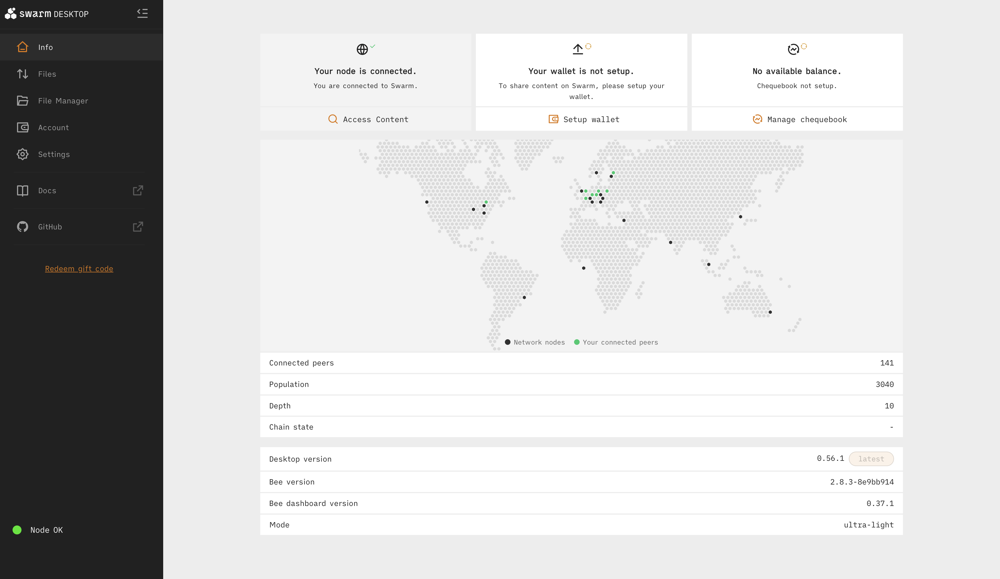
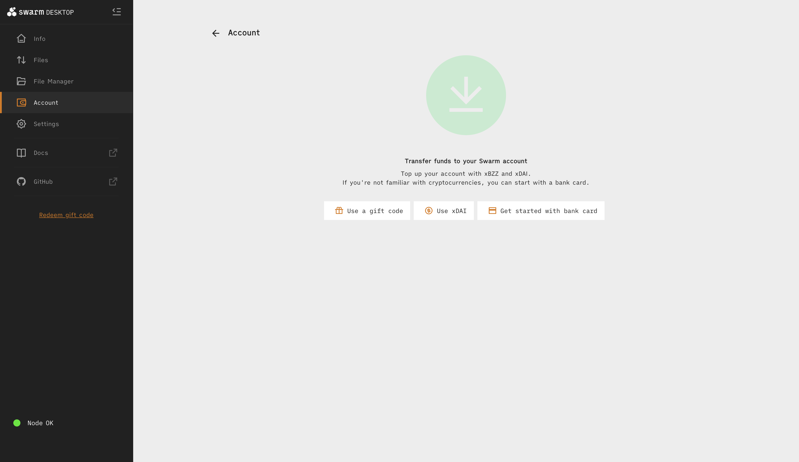
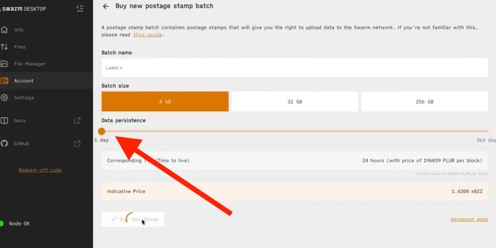
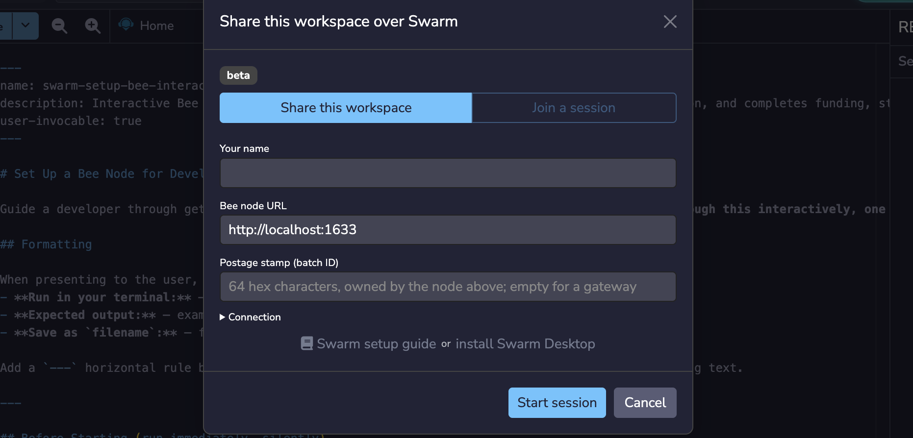
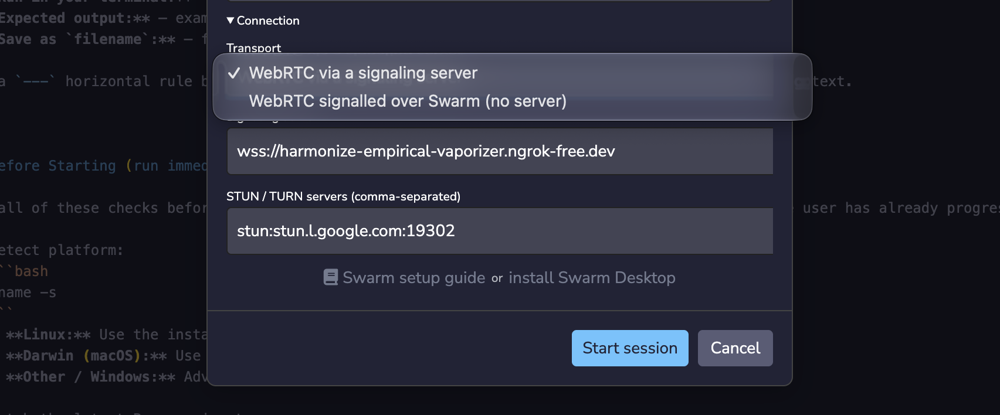
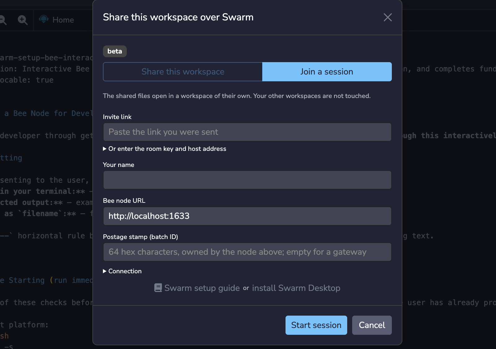

---
myst:
  html_meta:
    "description": "Edit a shared Remix Workspace with others in real time over Swarm. Buy a postage stamp, start a collaborative session, and invite collaborators."
    "keywords": "collaborative workspaces, real-time collaboration, swarm, swarm desktop, postage stamp, bzz, xbzz, remix ide"
---

# Collaborative Workspaces with Swarm

You can invite other people to a Workspace on Remix, allowing them to see and edit files on it in real-time. To keep a session private, you can run it over Swarm with no server in the middle.

This is useful for pair programming, debugging a contract with a teammate, or reviewing code together as you write it. Collaborators can also work in the same Workspace at different times, and anyone in a session can use RemixAI to update code, so your teammates can review and correct an agent's changes as they happen.

```{note}
Collaborative Workspaces are in beta, so for now they work best with just a few collaborators.
```

## Setup Collaborative Workspaces on Remix

To use collaborative Workspaces in Remix, first install and set up [Swarm Desktop](https://docs.ethswarm.org/docs/desktop/introduction/) on your machine.

### Swarm Desktop

Swarm Desktop connects you to the Swarm network, which Remix uses for your session. It also holds the wallet you use to buy a Postage Stamp.

Once installed, Swarm Desktop opens a local page like this:



Go to the **Account** page to set up your wallet. You can fund it with a gift code, xDAI, or a bank card:



Postage stamps are prepaid credits, funded with xBZZ tokens, that pay for storing your data on Swarm. You enter a stamp's batch ID when you start a session in Remix, and that stamp pays for any data the session stores on Swarm.

Swarm Desktop must be running as a light node before you can buy Postage Stamps. To buy one, go to **Account**, open **Stamps**, and click **Buy New Postage Stamp**.

Enter a **Batch name** and choose a **Batch size**. 4 GB is the smallest option. Then use the **Data persistence** slider to select the number of days you want your data to be persisted for, so you do not pay for more storage than you need, and click **Buy New Stamp**. **1 day** suits a single coding session with humans or agents. Choose longer if you plan to work in the Workspace across several days.



```{note}
Buying the Postage Stamps might take a while.
```

Once you have your Stamps, copy the batch ID from the stamp's details on the **Stamps** tab and move over to Remix.

### Remix

On Remix, activate the "Collab" plugin from the Plugin Manager. This will bring up the **Share this workspace over Swarm** modal, where you enter your name and your stamp's batch ID to start a session. **Bee node URL** is already set to `http://localhost:1633`, and the stamp must be owned by that node. If you connect through a gateway, leave the stamp field empty.



Fill in the form, then expand **Connection** and open the **Transport** dropdown for further configuration options. Check this setting before you start: if **WebRTC via a signaling server** is selected, your session uses a server. To run your session without one, select **WebRTC signalled over Swarm (no server)**.



Click **Start session**. Remix then opens another modal with your invite link. Click **Copy Invite** to copy the link, which has the room key in its URL, and send it to your collaborators.

You can also join a session someone else started. In the **Share this workspace over Swarm** modal, select **Join a session**, paste the invite link you were sent or enter the room key and host address, add your name, and click **Start session**. The **Bee node URL** and **Postage stamp (batch ID)** fields work the same way as when you share a Workspace. The shared files open in their own Workspace, so your other Workspaces aren't affected.



## Working in a session

While a collaborator is connecting, a yellow dot appears next to their name. The dot turns green when the connection is ready.

When you open the same file, you each see a named cursor that shows where the other person is working. Everyone in the session can edit any file in the Workspace.

To learn more about Swarm Desktop and Postage Stamps, see the [Swarm documentation](https://docs.ethswarm.org).
